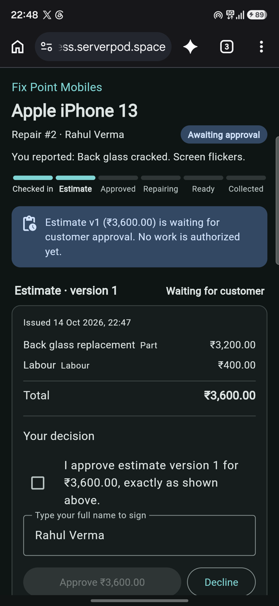
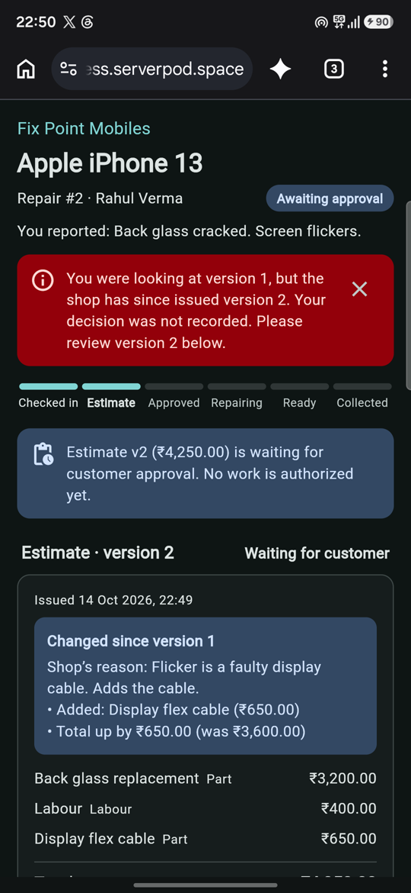
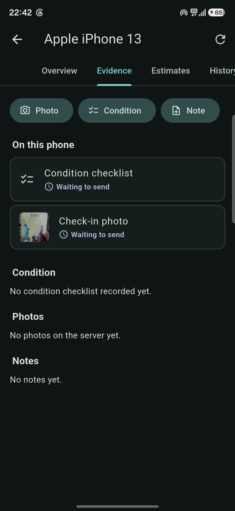
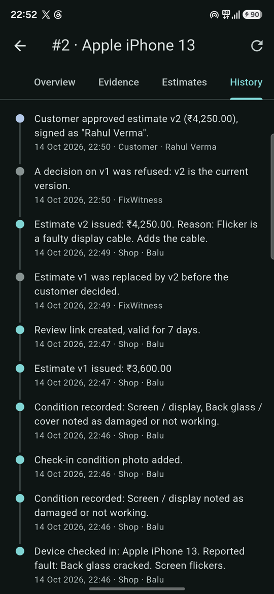

# FixWitness

Repair records an independent phone-repair shop and its customers can both trust.

- **Shop app** (Flutter, Android; also runs in a browser for the counter PC): check in a device,
  record its condition with a checklist and photos (works offline), issue estimates, track the
  repair, hand the device back. Changes from the customer or a colleague appear on every shop
  device as they happen. The owner invites technicians with a one-time code.
- **Customer review page** (Flutter web, served by the server): one link per job, handed over as
  a QR code at the counter or shared to WhatsApp/SMS. The customer sees the condition record and
  photos, approves or declines the *exact* estimate version, sees what changed in a revision,
  and confirms collection.
- **Server** (Serverpod 4.0.4, PostgreSQL): validates every transition, stores immutable
  estimate versions, writes history in the same transaction as each change, deduplicates
  retried operations, and keeps evidence in private storage.

No payments, inventory, messaging integrations, automatic diagnosis or pricing. No AI features
in the product (how AI was used to build it: [AI_DISCLOSURE.md](AI_DISCLOSURE.md)).

## Try it

| | |
|---|---|
| Live web app (shop) and customer pages | https://fixwitness.serverpod.space/ (Serverpod Cloud) |
| Android app | [FixWitness-1.0.0.apk](https://github.com/professor-200629/fixwitness/releases/download/v1.0.0/FixWitness-1.0.0.apk) ([release](https://github.com/professor-200629/fixwitness/releases/tag/v1.0.0)) |
| Demo video (1:47) | see the submission |

Sign up with any email you can read (Serverpod Cloud emails the code), create a shop, check in a
device, issue an estimate and open **Customer link**: the QR code or the copied link is the
customer's page. Open it in another browser or on another phone, then issue a revised estimate
from the shop and press *Approve* on the old version to see the refusal.

| Customer: one exact version | Customer: old version refused | Shop: offline queue | Shop: history |
|---|---|---|---|
|  |  |  |  |

Screens from a Samsung phone (Android 16) against the Cloud deployment, 2026-10-14.

## Why

In a small repair shop the arguments are always the same: "the screen wasn't cracked when I gave
it to you", "I never agreed to ₹4,000", "you said it would be ₹3,200". FixWitness keeps a record
neither side can quietly change. The condition is written down with photos at check-in. The
customer approves one exact estimate version, identified by a content hash, from their own phone,
so an approval of v1 can never be counted as an approval of v2. Every step goes into a history
that both the shop and the customer can read.

## Repository layout

```
fixwitness_server/   Serverpod server: models (lib/src/models), endpoints, business rules, tests
fixwitness_client/   Generated typed client (do not edit; regenerated by `serverpod generate`)
fixwitness_flutter/  Shop app + customer review page (lib/shop, lib/customer, lib/sync)
fixwitness_e2e/      Scripts that drive a running server over HTTP (e2e checks, demo seeding)
docs/                PLAN.md (design), DEMO.md (demonstration script)
STATUS.md            What is done, what was verified and how, open problems, next step
```

## How FixWitness uses Serverpod

| Serverpod feature | Used for | Where |
|---|---|---|
| Models + relations (`.spy.yaml`), migrations | 12 server tables (shops, members, jobs, immutable estimate versions, decisions, customer links, condition reports, photos, notes, history, invites, upload grants) and 2 on-device tables | `fixwitness_server/lib/src/models`, `migrations/` |
| Transactions with row locks (`LockMode.forUpdate`) | Approve-vs-revise races resolve to one serial order; history written in the same transaction | `lib/src/endpoints/*`, `lib/src/fixwitness/workflow.dart` |
| Server events + streaming endpoint | `shop.watch()` streams job changes to every device of the shop; the customer's approval appears at the counter at once | `lib/src/fixwitness/live.dart`, `shop_endpoint.dart` |
| Future calls (recurring) | Hourly sweep of photo bytes that were uploaded but never registered as evidence (Serverpod Cloud's Starter plan switches future calls off; the server then starts without the sweep) | `lib/src/fixwitness/maintenance.dart`, `lib/server.dart` |
| Cloud storage (private) + direct upload descriptions + `verifyUpload` | Evidence photos never pass through the API; interrupted uploads are recognised and resumed | `evidence_endpoint.dart` |
| Client-side database (`database: client`) | The Android offline outbox and job cache are Serverpod models in on-device SQLite | `cached_job.spy.yaml`, `pending_operation.spy.yaml`, `fixwitness_flutter/lib/sync` |
| Auth (email identity provider, JWT) | Shop accounts; customers never sign in, they use a hashed, expiring, revocable link | `lib/server.dart`, `lib/src/fixwitness/links.dart` |
| Web server (Relic routes + middleware) | Serves the Flutter web app with a gzip/ETag middleware for phones on mobile data | `lib/src/web/precompressed.dart` |
| Test tools (`withServerpod`) + embedded PostgreSQL | 33 integration tests on a real server and database, no Docker | `fixwitness_server/test/integration` |
| Serverpod Cloud | Hosting, database, storage and sign-up email for the public demo | see "Deploying" |

## Setup (Windows, macOS or Linux)

Requirements: Flutter 3.44.4 or newer (tested with 3.47.6 / Dart 3.13.5) and the Serverpod CLI.
No Docker and no PostgreSQL install are needed for development: Serverpod 4 runs an embedded
PostgreSQL for the `development` and `test` run modes.

```bash
dart install serverpod_cli          # Serverpod CLI 4.0.4
git clone <this repo> fixwitness && cd fixwitness
dart pub get                        # resolves the whole workspace
```

Secrets are not in the repository. Create `fixwitness_server/config/passwords.yaml` with values
for `development` and `test` (any long random strings; `database` can be any string for the
embedded database):

```yaml
development:
  database: '<random>'
  serviceSecret: '<random>'
  emailSecretHashPepper: '<random>'
  jwtHmacSha512PrivateKey: '<random 64+ chars>'
  jwtRefreshTokenHashPepper: '<random>'
test:
  database: '<random>'
  emailSecretHashPepper: '<random>'
  jwtHmacSha512PrivateKey: '<random 64+ chars>'
  jwtRefreshTokenHashPepper: '<random>'
```

> **Windows inside the Claude desktop app only:** set `SERVERPOD_PG_CACHE_DIR` to a folder
> outside `%LOCALAPPDATA%` (for example `C:\dev\tools\serverpod-pg`). The app's packaged-process
> file virtualization otherwise makes the embedded PostgreSQL think another process owns it.

### Run the server and the web apps

```bash
# Build the Flutter web bundle that the server serves on port 8082
cd fixwitness_flutter
flutter build web --base-href /            # Git Bash: prefix MSYS_NO_PATHCONV=1
# then copy build/web to ../fixwitness_server/web/app and gzip it for the server:
#   cd ../fixwitness_server && dart tool/precompress_web.dart web/app
# (or do all of it with: cd ../fixwitness_server && serverpod run flutter_build)

cd ../fixwitness_server
dart run bin/main.dart --apply-migrations  # API :8080, web :8082
```

Open http://localhost:8082 for the shop app. Sign-up verification codes are printed in the server
log and appended to `fixwitness_server/.serverpod/development/dev_mailbox.jsonl` (development
mode only; staging/production use the Serverpod Cloud email service).

`serverpod start` also works and adds hot reload plus the Serverpod MCP bridge for coding agents.

### Run the Android shop app

```bash
cd fixwitness_flutter
flutter run -d <device> --dart-define=SERVER_URL=http://10.0.2.2:8080/   # emulator -> host
# physical phone on the same Wi-Fi: SERVER_URL=http://<your-PC-LAN-IP>:8080/
```

Debug builds allow plain HTTP to a development server; release builds need HTTPS.

Photo upload and download URLs are built from the server's *public host*, which defaults to
`localhost` in development. A phone or emulator cannot use that, so start the server with your
PC's LAN IP:

```bash
# PowerShell: $env:SERVERPOD_API_SERVER_PUBLIC_HOST="192.168.1.20"; $env:SERVERPOD_WEB_SERVER_PUBLIC_HOST="192.168.1.20"
SERVERPOD_API_SERVER_PUBLIC_HOST=192.168.1.20 SERVERPOD_WEB_SERVER_PUBLIC_HOST=192.168.1.20 dart run bin/main.dart --apply-migrations
```

### Tests

```bash
cd fixwitness_server && dart test        # 33 integration tests, real server + embedded PostgreSQL
cd fixwitness_flutter && flutter test    # 11 offline-queue and cache tests on real SQLite
# with the development server running:
cd fixwitness_e2e && dart run bin/e2e.dart                   # 42 HTTP + websocket end-to-end checks
dart run bin/e2e.dart --phase before-restart                 # then restart the server and:
dart run bin/e2e.dart --phase after-restart                  # persistence check
```

Stop the development server before `dart test` on Windows: the running server holds a native
SQLite DLL that the test runner needs to replace.

## Temporary public demo (ngrok, from this PC)

ngrok's free plan gives one domain, so a small proxy puts the API and the web app on one origin:

```bash
ngrok config add-authtoken <token> --config deploy/ngrok-auth.local.yml   # once; file is gitignored
node deploy/one-origin-proxy.js                                           # :8088 -> api :8080 / web :8082
# start the server with the public domain so photo and customer-link URLs use it:
#   SERVERPOD_API_SERVER_PUBLIC_HOST / _PORT=443 / _SCHEME=https, and the same for WEB_SERVER
ngrok start --all --config deploy/ngrok-auth.local.yml --config deploy/ngrok-tunnels.yml
cd fixwitness_flutter && flutter build apk --debug --dart-define=SERVER_URL=https://<domain>/
```

Browsers see ngrok's warning page once (it shows the host's IP address); the Android app does not.
The link works only while this PC runs the server, proxy and tunnel. Insights and the database are
not exposed. The server still runs in development mode: sign-up codes go to the dev mailbox file.

## Deploying

The public demo runs on **Serverpod Cloud**:

| | URL |
|---|---|
| Web (shop app + customer pages) | https://fixwitness.serverpod.space/ |
| API | https://fixwitness.api.serverpod.space/ |

Cloud provides the PostgreSQL database (migrations run on deploy), the `private` storage that
holds evidence photos, the email service that sends sign-up codes, and TLS. Passwords and
config files never leave this machine (`.scloudignore`); Cloud generates its own.

```bash
# once: project with a database, then link this folder to it
serverpod cloud project create fixwitness --plan starter --enable-db
cd fixwitness_server && serverpod cloud project link fixwitness
# every deploy: scloud.yaml runs `serverpod generate` and `serverpod run flutter_build` first
serverpod cloud deploy
# the Android app for the deployment
cd ../fixwitness_flutter && flutter build apk --release --dart-define=SERVER_URL=https://fixwitness.api.serverpod.space/
```

Any other host that runs Dart or Docker also works (`fixwitness_server/Dockerfile`,
`--mode production`), with an external PostgreSQL, an S3/GCS/R2 bucket for the `private`
evidence storage (see `server.dart`), and an email provider configured for sign-up codes.
